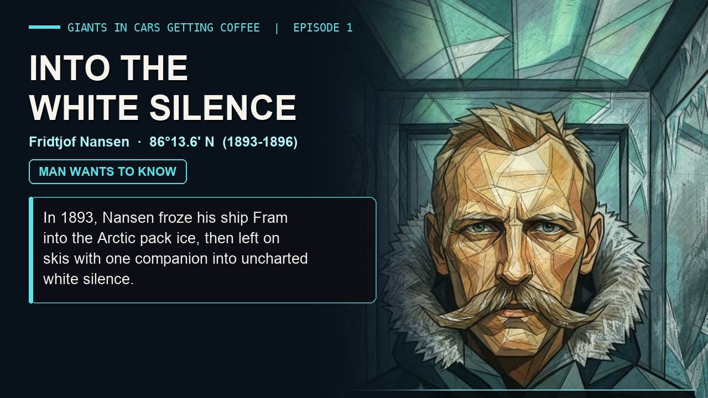
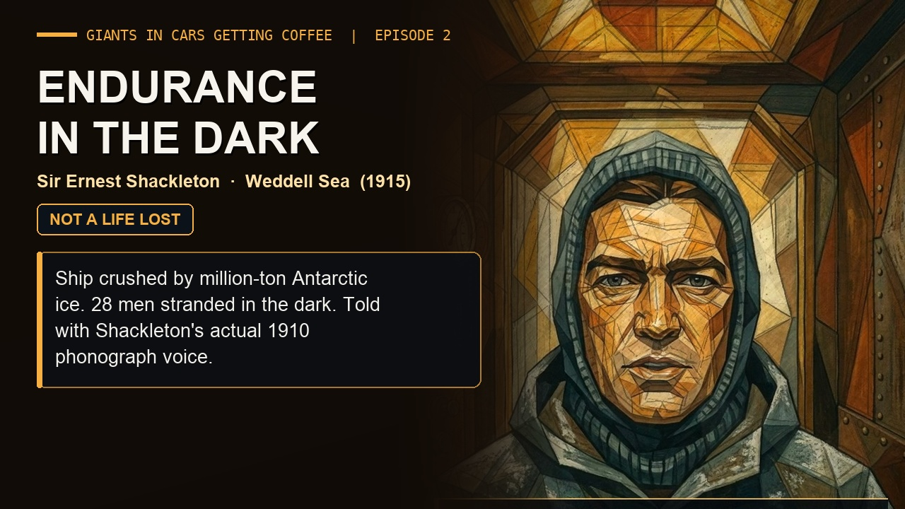
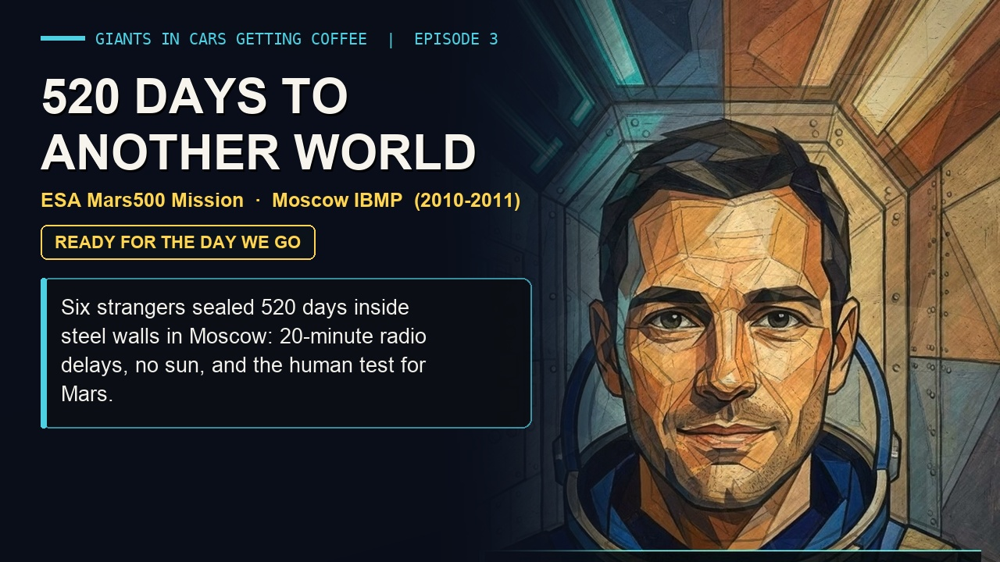
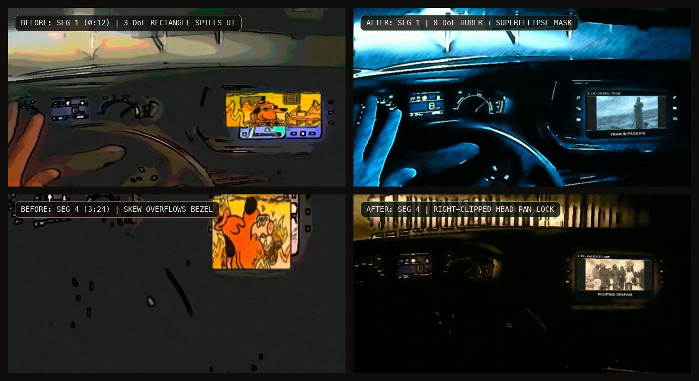
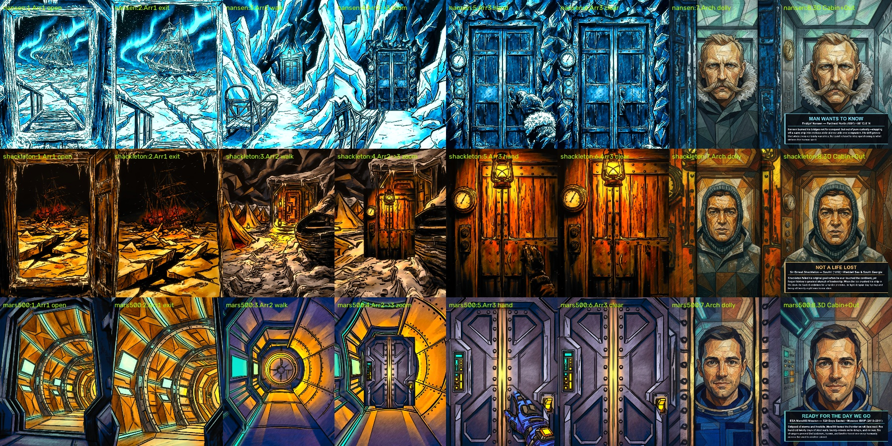

# Night-Chalk Drive

These scripts turn a night drive around Sabadell, Spain into three *Take On Me* style animated shorts. I shot the raw clips on Meta Ray-Ban (Gen 2) glasses, keeping the audio and dashboard in view while driving home.

The full engineering note is on my site at [carloscrespomacaya.com/notes/night-chalk-drive/](https://carloscrespomacaya.com/notes/night-chalk-drive/) and published in [Towards AI](https://pub.towardsai.net/night-chalk-drive-a-12-fps-rotoscope-pipeline-from-meta-ray-ban-night-footage-e118341b766e?sk=aef5cbca2251a687690317e1eb2cfe03).

| Ep. 1: Fridtjof Nansen | Ep. 2: Sir Ernest Shackleton | Ep. 3: ESA Mars500 |
| --- | --- | --- |
| [](https://youtu.be/viGtHeIcbxI) | [](https://youtu.be/8sN2TDPnP0E) | [](https://youtu.be/devbEUMNzms) |

## The episodes (*Giants in Cars Getting Coffee*)

I picked Nansen, Shackleton, and ESA Mars500 because all three crews went into harsh isolation and brought everyone back alive.

| Episode | Archival source | Look & speed | Runtime | Watch |
| --- | --- | --- | --- | --- |
| **Ep. 1: Fridtjof Nansen** (*Into the White Silence*) | *Fram* Arctic drift; LibriVox *Farthest North* | Silver-ice (`step=18`), cyan glow, hyper-lapse | `4:40` (`6,720` f) | [YouTube](https://youtu.be/viGtHeIcbxI) / [X](https://x.com/macayaven/status/2123420715965698298) |
| **Ep. 2: Sir Ernest Shackleton** (*Endurance in the Dark*) | Weddell Sea rescue; *South!* + 1910 phonograph | Amber noir (`step=32`), lantern flicker, slow-heavy | `4:00` (`5,760` f) | [YouTube](https://youtu.be/8sN2TDPnP0E) |
| **Ep. 3: ESA Mars500** (*520 Days to Another World*) | Moscow IBMP hatch; ESA interviews (CC BY-SA 3.0 IGO) | Teal blueprint thawing to daylight gold | `4:15` (`6,120` f) | [YouTube](https://youtu.be/devbEUMNzms) |

## From v1 to v2

An earlier coding-agent pass got a rough color-cartoon cut working ([media_base.py](pipeline/media_base.py)) alongside a 3-DoF template tracker ([baseline_v1_template_tracker.py](pipeline/baseline_v1_template_tracker.py)). Watching those renders showed several clear problems. Stickers slid off the car display when my head turned, dark sky turned chalky gray, and the ending still walked through my real parking garage into an elevator mirror.

I took over from that v1 baseline, kept the original MOV clips untouched, and rebuilt the pipeline on top of them. The v2 pass switched tracking to raw luminance with 4-edge Huber intersection and Lucas-Kanade bridging (`874` locked visible poses before parking, `0.00 px` jitter within each held frame pair). I also split the car body from the infotainment display in CIE-Lab space so skies stay black, cut the real walk at pose `2989` in favor of 6-DoF pinhole camera projection (`FOCAL = 660 px`) over illustrated arrival plates, and mixed the archival narration with an RMS ducking curve targeting `-14.0 LUFS`.



## Files in this repo

| Path | What it does |
| --- | --- |
| [pipeline/paths.py](pipeline/paths.py) | Reads `NIGHT_CHALK_DATA_DIR` for large media folders and points to tracked `data/` JSONs |
| [pipeline/media_base.py](pipeline/media_base.py) | Reorders the 5 MOV clips, retimes them to `288.0 s`, and holds the v1 cartoon builder |
| [pipeline/baseline_v1_template_tracker.py](pipeline/baseline_v1_template_tracker.py) | Original v1 3-DoF `cv2.matchTemplate` script kept for side-by-side comparison |
| [pipeline/planar_tracker_segments.py](pipeline/planar_tracker_segments.py) | Fits 4 Huber edges on raw frames (`contrast >= 52`), filters out skin, and bridges blur gaps |
| [pipeline/track_full_drive_display.py](pipeline/track_full_drive_display.py) | Tracks all `3,198` poses and projects off-screen right corners during sharp pans |
| [pipeline/quad_overlay.py](pipeline/quad_overlay.py) | Warps screen inserts into tracked quads with supersampled rounded bezel masks |
| [pipeline/display_mask.py](pipeline/display_mask.py) | Builds stylized screen crops and mask shapes |
| [pipeline/night_chalk_shader.py](pipeline/night_chalk_shader.py) | `ChalkRotoscopeEngine`: bilateral smoothing, CIE-Lab shadow curve, 12-fps hatching, ink edges |
| [pipeline/cubist_portrait.py](pipeline/cubist_portrait.py) | Delaunay portrait shader with temporal EMA color smoothing |
| [pipeline/fetch_archival_media.py](pipeline/fetch_archival_media.py) | Cuts LibriVox, Internet Archive, Edison cylinder, and ESA clips to time |
| [pipeline/audio_dsp.py](pipeline/audio_dsp.py) | RMS envelope follower (`0.16 s` attack, `0.28 s` release) ducking music under speech |
| [pipeline/build_audio_mix.py](pipeline/build_audio_mix.py) | Renders and loudnorm-balances the three `-14.0 LUFS` WAV mixes |
| [pipeline/build_dashboard_screens.py](pipeline/build_dashboard_screens.py) | Generates the `18` `72-frame` dashboard video loops |
| [pipeline/build_trilogy_tails.py](pipeline/build_trilogy_tails.py) | Renders the concave 3D cabin hero shots and Outro cards |
| [pipeline/build_trilogy_films.py](pipeline/build_trilogy_films.py) | Runs the shared driving pass, applies speed curves, and composites screen loops |
| [pipeline/build_3d_finales.py](pipeline/build_3d_finales.py) | Runs the 6-DoF pinhole raycaster (`_project_3d_layer`), gait curves, door mirroring, and `GrabCut` arm extraction |
| [pipeline/build_article_assets.py](pipeline/build_article_assets.py) | Renders the 2x2 diagnostic clip, comparison images, and `og.png` |
| [data/track_quads_full_drive.json](data/track_quads_full_drive.json) | Saved 8-DoF screen quads across `3,198` poses (`874` visible before park stop) |
| [data/track_quads_expedition.json](data/track_quads_expedition.json) | Anchor quads for the six main glance windows |
| [docs/TRILOGY_CREDITS_AND_TIMELINE.md](docs/TRILOGY_CREDITS_AND_TIMELINE.md) | Chapter timestamps, transcripts, and public-domain / CC attributions |
| [tests/test_pipeline_geometry.py](tests/test_pipeline_geometry.py) | Checks module imports, quad bounds, sky blackness, 6-DoF projection, audio ducking, and repo hygiene |



## Tests and media rebuilds

The unit tests cover shader black clamping, 6-DoF camera math, quad JSON bounds, and RMS ducking without needing the raw video files:

```bash
uv sync
uv run pytest -q
```

If you want to re-render the full MP4s from local source media (`videos/`, `music/`, `work/`), set `NIGHT_CHALK_DATA_DIR` to that folder. Rebuilding the base cut uses `ffmpeg` with Apple Silicon `videotoolbox` hardware encoding, so on Linux you would swap that encoder flag in `media_base.py` to `libx264`:

```bash
export NIGHT_CHALK_DATA_DIR=/path/to/your/media-bundle
uv run python -m pipeline.build_trilogy_films all
uv run python -m pipeline.build_3d_finales all
```

## Attribution

I shot the source footage, picked the stories, reviewed every contact sheet and render, and made the architecture and editorial calls. The initial v1 prototype (`media_base.py`, `baseline_v1_template_tracker.py`) came from an early coding-agent pass using Muse Code (`muse-wonder-full-1.0 · xhigh`). Taking the pipeline from that rough prototype to the tested v2 implementation (8-DoF planar tracker, CIE-Lab night shader, 6-DoF 3D portals, unit tests, and repo packaging) was built iteratively with Google Antigravity (powered by Gemini models).

## License

Code in `pipeline/` and `tests/` uses the [MIT License](LICENSE). Archival voices and clips keep their own public-domain and Creative Commons terms listed in [docs/TRILOGY_CREDITS_AND_TIMELINE.md](docs/TRILOGY_CREDITS_AND_TIMELINE.md).
